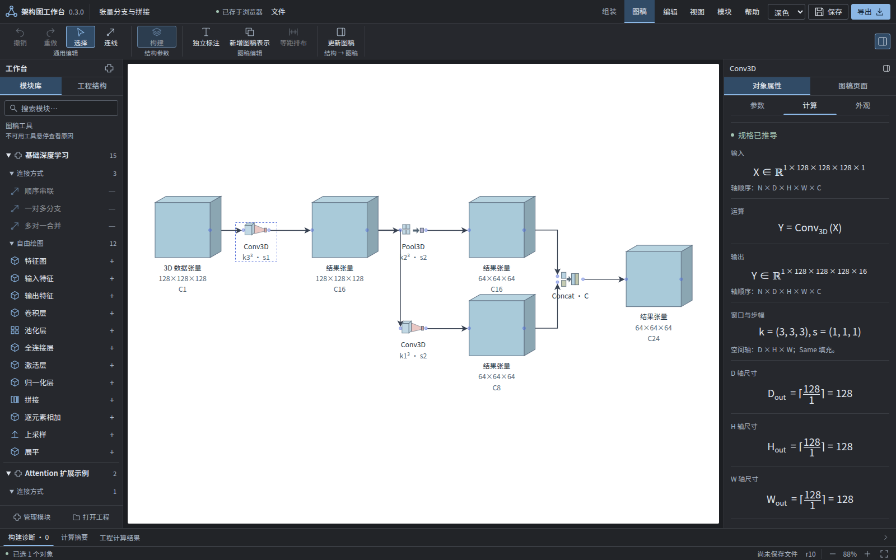

# Network Figure Studio

**Build a network diagram, check tensor shapes, and turn it into a figure for your paper or presentation.**

A local browser workbench for planning deep learning architectures. Assemble data flows, inspect shape calculations and formulas, then adjust layout, colors, and labels in the drawing workspace. Export SVG or PNG. No account or backend required.

[简体中文](README.md) · [Quick start](#quick-start) · [Editable examples](#start-with-an-example) · [User guide · 中文](docs/user-guide.md) · [Report an issue](https://github.com/xingalwang/network-figure-studio/issues)

[](https://github.com/xingalwang/network-figure-studio/actions/workflows/ci.yml)
[](https://github.com/xingalwang/network-figure-studio/tree/v0.3.0)
[](LICENSE)



_Actual v0.3.0 interface with the editable “3D branching and concatenation” project included in this repository._

## From a network idea to a paper figure

Drawing a network often means checking shapes while arranging blocks: what comes out of this convolution? Can these branches be concatenated? Can a block look smaller without changing its tensor dimensions?

| Your task                   | What the workbench offers                                                                                           |
| --------------------------- | ------------------------------------------------------------------------------------------------------------------- |
| Plan the architecture       | Assemble 2D／3D data, convolutions, pooling, activations, and branches as visual data flows                         |
| Check shapes and parameters | Inspect supported operators' output shapes, parameter counts, formulas, and diagnostics; locate conflicting objects |
| Arrange the figure          | Edit display size, visual depth, projection, colors, and text separately from tensor specifications                 |
| Export and keep editing     | Export SVG／PNG, save editable projects, undo／redo, and use browser autosave with light or dark themes             |

Designed for students, researchers, and educators planning CNNs, explaining tensor transformations, or preparing figures for papers, teaching, and technical presentations.

For example, inspect a simple 2D pipeline with shapes written as **H × W × C**:

```text
Input            Conv2D             ReLU              MaxPool2D
64 × 64 × 3  →  64 × 64 × 16  →  64 × 64 × 16  →  32 × 32 × 16
```

This uses a 3 × 3 convolution with stride 1, same padding, and 16 output channels, followed by 2 × 2 pooling with stride 2 and valid padding. Display geometry can be adjusted separately.

## Quick start

Requires [Node.js](https://nodejs.org/) **24.15.0 or newer**.

```bash
git clone https://github.com/xingalwang/network-figure-studio.git
cd network-figure-studio
npm ci
npm run dev
```

Open [http://127.0.0.1:5173](http://127.0.0.1:5173/), select the modules you want, then create a project or open an example below. **The application interface is currently in Chinese.**

You can also [download the source ZIP](https://github.com/xingalwang/network-figure-studio/archive/refs/heads/main.zip), extract it, and run `npm ci` and `npm run dev` from the project directory.

For a production build and local preview:

```bash
npm run build
npm run start
```

The preview runs at [http://127.0.0.1:4173](http://127.0.0.1:4173/). Browser autosave is separate for ports 5173 and 4173; transfer projects using project files. Optional Windows／WSL launch instructions are in the [launcher guide · 中文](scripts/README.md).

## Start with an example

Open a file link and use GitHub's **Download raw file** button to save the `.nnfig.json` file, then select **打开工程** (Open project) in the app. If you cloned or downloaded the repository, open the files directly from `examples/projects/`.

| Editable project                                                                           | What to explore                                                                                  |
| ------------------------------------------------------------------------------------------ | ------------------------------------------------------------------------------------------------ |
| [2D convolution and upsampling](examples/projects/tensor-2d-demo.nnfig.json)               | How convolution, pooling, and upsampling change feature map shapes                               |
| [3D branching and concatenation](examples/projects/tensor-branch-demo.nnfig.json)          | Branch data flows, channel concatenation, and shape compatibility; shown in the screenshot above |
| [Residual composition](examples/projects/residual-demo.nnfig.json)                         | Modify an existing residual composition and inspect its preview and connections                  |
| [Multiple representations and annotations](examples/projects/figure-views-demo.nnfig.json) | Explore v3 figure representations and annotations with separate appearance settings              |

Start with the 2D example: select an operator, change its parameters on the right, click **构建** (Build), and inspect shapes and diagnostics. Use **加入图稿** (Add to figure) to arrange the diagram, then export SVG or PNG.

## Current scope

This introduction describes **v0.3.0**:

- **Data and operators**: 2D／3D data, Conv2D／3D, MaxPool2D／3D, ReLU, nearest-neighbor upsampling, Concat, and strict Add.
- **Figures and export**: vector editing, separate figure representations, and SVG／PNG export. PNG supports custom pixel dimensions and white or transparent backgrounds.
- **Local projects**: browser autosave, editable project files, and undo／redo. Older v1／v2 files remain readable and editable; newer figure features use an explicitly created v3 copy.
- **Extensions**: trusted plugins registered at build time. The [LeakyReLU example · 中文](examples/plugins/leaky-relu/README.md) demonstrates adding an operator.

This is a static design and drawing tool. It does not import PyTorch／TensorFlow models or run inference or training. Convolution groups and dilation are fixed at 1; upsampling uses positive integer factors per spatial axis. Missing information and shape conflicts are reported. Full image editing, cropping, layers, copy／paste, and free grouping interfaces are not yet available.

Download project files to keep your work beyond browser autosave. SVG preserves editable text by default and requires matching fonts on the viewing device. Font fallback, optional embedding, and detailed workflows are covered in the [user guide · 中文](docs/user-guide.md).

## Help improve it

Share the networks you need to draw, missing operators, or shape problems in an [Issue](https://github.com/xingalwang/network-figure-studio/issues). For bug reports, include reproduction steps and a minimal project you can share publicly.

If this helps you understand a network or saves you time drawing, consider giving it a **Star** so you can find it again. Contributions to documentation, fixes, and plugins are welcome.

Development checks:

```bash
npm run check
npx playwright install chromium
npm run verify
```

`check` runs formatting, module boundary, type, unit, and tooling checks. `verify` also runs browser checks and a production build. See the [contribution guide · 中文](docs/CONTRIBUTING.md) for Linux browser dependencies.

Documentation (Chinese): [User guide](docs/user-guide.md) · [Architecture](docs/architecture.md) · [Project format](docs/project-format.md) · [Plugin development](docs/plugin-development.md) · [Contributing](docs/CONTRIBUTING.md) · [Changelog](docs/CHANGELOG.md).

## License

Project code is licensed under [MIT](LICENSE). Dependencies and fonts retain their own licenses; see [third-party notices](docs/THIRD_PARTY_NOTICES.md).
